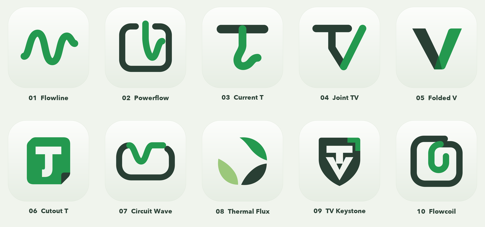

# Tilvero logo explorations — 2026-10-31

Ten original alternatives for the Tilvero identity: flowing energy marks, hybrids with the earlier power-loop, and custom T/V lettermarks. These are selection concepts.

| Concept | 1024 px image | Editable vector |
| --- | --- | --- |
| 01 Flowline | [PNG](png/01-flowline.png) | [SVG](svg/01-flowline.svg) |
| 02 Powerflow | [PNG](png/02-powerflow.png) | [SVG](svg/02-powerflow.svg) |
| 03 Current T | [PNG](png/03-current-t.png) | [SVG](svg/03-current-t.svg) |
| 04 Joint Tv | [PNG](png/04-joint-tv.png) | [SVG](svg/04-joint-tv.svg) |
| 05 Folded V | [PNG](png/05-folded-v.png) | [SVG](svg/05-folded-v.svg) |
| 06 Cutout T | [PNG](png/06-cutout-t.png) | [SVG](svg/06-cutout-t.svg) |
| 07 Circuit Wave | [PNG](png/07-circuit-wave.png) | [SVG](svg/07-circuit-wave.svg) |
| 08 Thermal Flux | [PNG](png/08-thermal-flux.png) | [SVG](svg/08-thermal-flux.svg) |
| 09 Tv Keystone | [PNG](png/09-tv-keystone.png) | [SVG](svg/09-tv-keystone.svg) |
| 10 Flowcoil | [PNG](png/10-flowcoil.png) | [SVG](svg/10-flowcoil.svg) |

[32 px comparison](small-size-check.png) shows each mark at native small size and enlarged.

## Design choices

The shared pale native-style tile is deliberately constant, so differences come from geometry. Palette: graphite `#293F34`, current green `#24994F`, sage `#9BC87B`, deep fold green `#176D3A`, paper `#F0F4ED`, tile `#FCFDFB` → `#E6EDE3`. There are no decorative glow effects, external images, traced brand assets or copied glyphs in the marks. The contact-sheet labels use the system-installed Avenir Next; no font file is distributed.

| No. | Concept | Construction and small-size assessment |
| --- | --- | --- |
| 01 | Flowline | Refines the current two-crest energy line. Clear at 32 px; remains a common waveform category. |
| 02 | Powerflow | The old square power-loop holds a stem that turns into a flowing V-shaped current. Clear at 32 px; strongest continuity between the two existing families. |
| 03 | Current T | A broad graphite T crossbar and a green flowing downstroke. Clear at 32 px; expressive open lower terminal. |
| 04 | Joint TV | One custom T stem turns into the left arm of V; a green arm rises on the right. Clear at 32 px; strongest compact lettermark. |
| 05 | Folded V | Two broad folded ribbons and a dark return plane. Very clear at 32 px, but a V alone has low conceptual distinctiveness. |
| 06 | Cutout T | A chamfered green body with a generously cut T and a curved terminal. Clear at 32 px; the small graphite corner becomes secondary. |
| 07 | Circuit Wave | A wide graphite circuit closes below a green upper wave. Clear at 32 px; a horizontal enclosure distinct from 02. |
| 08 | Thermal Flux | Three broad separated curved vanes connect the identity to cooling. Silhouette remains clear at 32 px; can also suggest leaves or ecology. |
| 09 | TV Keystone | Negative-space T and V inside a compact graphite keystone. Experimental: at 32 px the shield is clear, but the internal letters merge into a face-like glyph. |
| 10 | Flowcoil | The old square circuit curls inward into the green energy line. Clear at 32 px; stronger enclosure and quieter movement than 02. |

Recommendation: **02 Powerflow** for continuity and energy semantics, or **04 Joint TV** for a more ownable letter-based direction. **06 Cutout T** is the clearest filled alternative. These are design recommendations, not owner approval.

## Bounded similarity research

The initial pass inspected seven actual visual examples on official company/product pages or the publisher's App Store listing on 2026-10-31. A bounded broader waveform search and its closer verified comparisons are recorded below. The following are visual design judgments based on the inspected artwork. They are not an exhaustive image search, trademark search or legal clearance.

| Primary source | Observed logo | Comparison with these concepts |
| --- | --- | --- |
| [Tesla, Inc. — Tesla app listing](https://apps.apple.com/us/app/tesla/id582007913) | White pointed T with a separate curved upper arc on a red tile. | 03 and 04 use a straight, thick, joined crossbar and untapered downstroke; neither reproduces the split curved crown or needle stem. The letter T and energy subject remain a broad association. |
| [Tibber — official brand platform](https://tibber.design/logo) | A thin angular outlined lightning bolt beside a lowercase wordmark. | Shares the energy subject; none of the ten uses that outlined bolt geometry. The similar initial `Ti` is a naming association, not a matching mark. |
| [Veeam — Brand Resource Center](https://www.veeam.com/company/brand-resource-center.html) | The visible header has a white lowercase wordmark inside a bright-green horizontal chamfered badge. | 06 also combines green, a cut corner and negative lettering. Its tall, single-glyph body and folded lower corner differ; the shared badge vocabulary deserves attention if 06 advances. Only the visible header mark was compared, not every Veeam submark. |
| [Wavebox — official product website](https://wavebox.io/) | A purple/blue angular stacked, cube-like glyph. | The current Tilvero wave and 01 are not the same outline. Wave terminology alone does not establish visual similarity. |
| [AlDente — AppHouseKitchen](https://apphousekitchen.com/) | A dark fork and yellow pasta spiral inside a green native tile. | Shared charging-utility category and green tile. The internal silhouettes differ from Tilvero's waves, power-loop and lettermarks. |
| [Macs Fan Control — CrystalIDEA](https://crystalidea.com/macs-fan-control) | A literal blue multi-blade fan, center hub and metallic rounded housing. | 08 shares the cooling/fan family, but uses three separated flat leaf-like vanes without a hub or hardware housing. Its ecological reading is a separate design weakness. |
| [Volkswagen — official logo image](https://www.volkswagen-newsroom.com/en/images/detail/volkswagen-logo-30145) | Thin V over W within a circular outline. | 09 shares stacked angular negative spaces and a badge-like composition; its T/V letters, solid keystone and green corner differ. This is the strongest broad monogram association in the set, so 09 is not a first recommendation. |

The initial seven-brand pass did not identify a close complete-outline match. The broader follow-up below found a substantially closer waveform family, especially Deskflow. Generic waveforms, power glyphs, V marks, leaves and shields are crowded visual categories; the limited comparison cannot establish global uniqueness. The direct Tesla gallery and PDF were unavailable in this environment (gallery/direct PDF returned access denial; embedded PDF did not render). Tesla was instead visually verified on its Tesla, Inc. App Store listing; no claim relies on the unavailable PDF. No third-party logo artwork is included in the deliverables.

### Bounded broader waveform follow-up

One broader image query covered green wave/W marks across audio, monitoring and wellbeing applications; web results also covered MacWhisper, Welltory and Wave. Two discovered candidates warranted closer comparison. Their actual artwork was visually inspected from the official website or publisher's app-store listing, rather than treating image-search captions as evidence. Browser access was unavailable for this follow-up, so the primary artwork was retrieved and, for the WellSaid SVG, rendered in memory without changing any Tilvero image or adding third-party files to this package.

| Primary source | Observed logo | Nearest comparison |
| --- | --- | --- |
| [Deskflow — publisher's Shopify App Store listing](https://apps.shopify.com/deskflow) | A thick continuous green W on white, with two deep rounded troughs, one central crest and flat horizontal terminal caps. | A materially closer visual family to 01 than the original seven examples: green, uniform heavy waveform and a light field. 01 has two upper crests, one main lower trough, round caps and an asymmetric exit; the full path differs, but the shared waveform character is strong. This reduces 01's distinctiveness and supports choosing 02 or 04 instead. |
| [WellSaid — official website](https://www.wellsaid.io/) | A mint-green interwoven W/ribbon with closed loops and a crossing, displayed beside the WellSaid wordmark. | Shares rounded green flow with 01 and, more broadly, the coiling idea of 10. Its closed interlaced topology differs from 01's open line and 10's single inset curl. It is a relevant neighboring identity, not a complete-outline match. |

The follow-up did not change the recommendation: 02 and 04 remain stronger than the free wave for a Tilvero identity. It does not establish legal availability or exhaust the wave/W logo space.

## Files and license

Each concept has a 1024 × 1024 PNG, a code-native SVG and an independently rendered 32 × 32 PNG. No external image, font file or third-party logo is embedded in the SVGs. Contact-sheet labels use the system-installed Avenir Next font; no font software is distributed. The source vectors can be rasterized with an existing SVG renderer.

Original Tilvero geometry, Copyright (c) 2026 RaNDoM6913, GPL-3.0-only. Comparison links do not grant rights to third-party marks. `manifest.json` records exact original file hashes.
