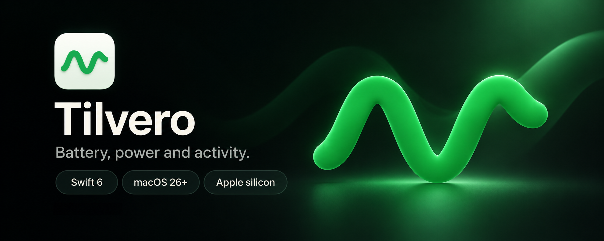
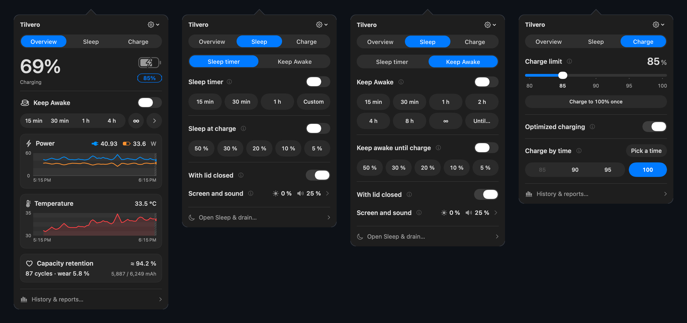
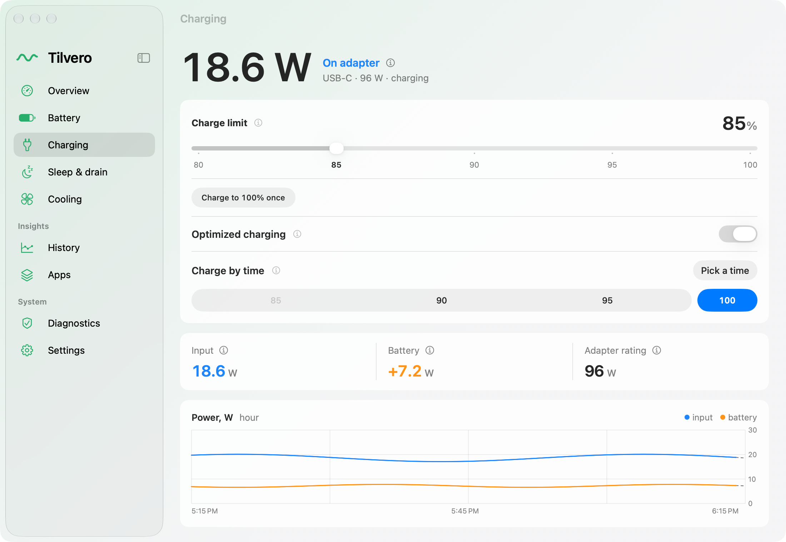

<p align="center">
  <a href="https://github.com/RaNDoM6913/Tilvero/releases/latest"></a>
  <a href="docs/GITHUB_TRAFFIC.md"></a>
  <a href="LICENSE"></a>
</p>

<p align="center"><strong>English</strong> · <a href="README.ru.md">Русский</a></p>

**Free, open-source battery and power app for the Mac menu bar.** Battery health, the macOS charge limit,
a sleep timer and Keep Awake in one quick menu, for Apple silicon Macs on macOS 26 and later.
No account, no cloud, no ads, no telemetry.

Tilvero lives in your menu bar. One quick menu shows your battery and power,
keeps your Mac awake or sleeps it on a timer, and sets the macOS charge limit,
with a clear native window when you want the details. If you use a charge limiter, a keep-awake app
and a battery-health viewer today (for example AlDente, Amphetamine and coconutBattery), Tilvero covers
all three jobs in one native app.



<sub>Overview · Sleep timer · Keep Awake with the Screen and sound row · Charge. Screenshots use sample readings.</sub>

## Install

You need an **Apple silicon Mac with macOS 26.0 or later** and **[Xcode](https://apps.apple.com/app/xcode/id497799835)**
(free from the App Store; open it once after installing). One command builds Tilvero on your Mac and puts it in Applications:

```sh
git clone https://github.com/RaNDoM6913/Tilvero.git && cd Tilvero && bash scripts/install.sh
```

The first build takes a few minutes. Tilvero then appears in the menu bar; click the battery icon.
`bash scripts/install.sh --check` only checks the requirements, and `--applications-dir ~/Applications`
installs without touching `/Applications`. To update, run `git pull && bash scripts/install.sh` in the same folder.
To remove Tilvero, quit it and move it to the Trash. A signed, notarized download is in preparation.

### Install with an AI agent

Tell your coding agent (Claude Code, Codex, Cursor and similar):

> Install Tilvero on this Mac from https://github.com/RaNDoM6913/Tilvero following the "Notes for AI agents" section of its README.

<details>
<summary><strong>Notes for AI agents</strong></summary>

Tilvero is a native Swift 6 menu bar app built from this repository. To install it for the user:

1. Clone the repository (`git clone https://github.com/RaNDoM6913/Tilvero.git`) and `cd` into it.
2. Run `bash scripts/install.sh --check`. If it fails, report the message to the user: it names the missing
   requirement (Apple silicon, macOS 26.0+, or a full Xcode install; Command Line Tools alone are not enough).
   Installing Xcode is the user's decision.
3. Run `bash scripts/install.sh`. It builds a release copy, verifies its code signature and installs `Tilvero.app`
   into `/Applications`, keeping any previous copy in `build/install.noindex/`. If `/Applications` is not writable,
   use `--applications-dir ~/Applications`. Pass `--no-launch` if the user does not want it opened now.
4. Do not use `sudo`, do not change Gatekeeper or quarantine settings, and do not register helpers or run
   other scripts from `scripts/`. If the script refuses (Tilvero is running, or a signed copy is already installed),
   tell the user what it said instead of working around it.
5. Tell the user: Tilvero is in the menu bar (battery icon); a new install opens a short setup window once.

The installer and the automated tests (`bash scripts/test.sh`, optional via `--with-tests`) never change charging,
fan, power or sleep settings. Those change only when the user turns a control on inside the app.

</details>

## What the quick menu does

- **Overview:** the battery level and state, the macOS charge limit at a glance, Keep Awake in one tap, and live
  charts for power (adapter and battery in one chart) and temperature, and a capacity-retention card (cycles, wear and capacities) below.
  Blocks, order and chart size are yours to arrange; the duration and level buttons of the sleep controls are editable in Settings > Quick menu.
- **Sleep:** a sleep timer you can extend by 5 minutes, 15 minutes or an hour; Keep Awake for a set time or until you stop it,
  with an optional **With lid closed** switch that also turns the screen down and caps the volume while the lid is shut; and
  sleep or keep awake when the charge falls to a level you choose.
- **Charge:** the macOS charge limit (80–100 %), a one-time charge to 100 %, and **charge by time**: pick a time and a level
  and Tilvero lifts the limit just in time, waking a sleeping Mac on schedule (one optional administrator permission;
  waking with the lid closed is still being verified on real hardware).
- **First run:** a brand-new install opens one setup window (launch at login, history, the closed-lid option and charge by time).
  Existing installs never see it.

## Why Tilvero

- **One app instead of three:** charge limit, keep awake and sleep timer, battery health and history.
- **Native and light:** Swift 6, AppKit and SwiftUI; low CPU use when idle; a closed quick menu measures nothing.
- **Honest numbers:** every reading has a source and a time; a missing value is shown as unavailable, never as a made-up zero.
- **Safe controls:** Tilvero uses the macOS charge limit, reads every change back and restores what it changed. Your own limit always wins.
- **Private by design:** no account, no cloud, no telemetry. History stays on your Mac.
- **Free software:** GPL-3.0, no subscription, no paid tier.

## More than the menu: a closer look at your Mac

| See | What Tilvero shows |
| --- | --- |
| Battery at a glance | Menu bar charge, power source and a compact panel with configurable blocks and indicator sizing |
| Battery health | Available capacity, temperature, cycle and cell readings, with measurement sources and freshness |
| Power and charging | Battery power, reported system load and adapter input/capability kept distinct; system charge-limit readback |
| Apps | Searchable process activity, CPU load, CPU energy/power estimates, wakeups and disk I/O, with partial coverage made visible |
| History and reports | Local charts, minute samples, hourly summaries and previewable CSV/JSON exports; gaps stay visible |
| Sleep & drain | App-observed sleep/wake intervals and current sleep blockers, with incomplete evidence clearly marked |
| A panel that fits | Rearrange or hide blocks, choose Russian or English, and adjust menu bar text and icon size |

The catalog describes **115 fields**. Your Mac determines which are available;
missing values stay unavailable. Monitoring needs no administrator approval.

## The main window

**History & reports…** opens the main window: a glass sidebar column (it narrows to an icon rail) and nine pages.
Screenshots use sample readings.

<table>
  <tr>
    <td width="50%"><strong>Overview</strong><br><a href=".github/assets/screenshots/overview.png"></a></td>
    <td width="50%"><strong>Battery</strong><br><a href=".github/assets/screenshots/battery.png"></a></td>
  </tr>
  <tr>
    <td width="50%"><strong>History</strong><br><a href=".github/assets/screenshots/history.png"></a></td>
    <td width="50%"><strong>Charging</strong><br><a href=".github/assets/screenshots/charging.png"></a></td>
  </tr>
</table>

## What's new in 0.8.0

A redesigned main window, a safer **With lid closed** and an upgraded, faster history store.

**New**
- **A redesigned main window.** A glass sidebar column lists Overview, Battery, Charging, Sleep & drain, Cooling, History, Apps, Diagnostics and Settings; it narrows to an icon rail with **⌃⌘S** (the choice is remembered). Pages with several views (Battery, Sleep & drain, Settings) keep their tabs in the toolbar. The Charging page puts the charge limit, the one-time full charge and charge by time beside the power chart and adapter readings. The Apps page lists process activity, and Diagnostics is tidier.
- **Editable quick-menu presets.** Settings > Quick menu lets you change the duration and level buttons of the sleep timer, Keep Awake, Sleep at charge and Keep awake until charge.
- **A watchdog for With lid closed.** The switch changes a system-wide sleep setting that outlives the app. Each session now starts a small helper process (a second copy of the app) and records a marker on disk. If Tilvero crashes, is force-quit or is killed, the helper puts normal sleep back, but only while the marker is still its own. It can restore sleep but cannot disable it.
- **A one-time cleanup of an old leftover.** Up to 0.7.1 a run that ended without restoring could leave sleep disabled. At the first launch of 0.8.0 Tilvero clears it only when a With lid closed switch is on and Tilvero's own passwordless rule is installed, with no prompt. Without that evidence it touches nothing and the usual warning shows.
- **Live battery power once a second** while a live chart is on screen (read from the SMC), instead of the once-a-minute registry value.
- **A new app icon and banner.**

**Changed**
- **The capacity-retention card shows cycles and wear on one line**, with the capacities small beside them.
- **The power chart legend uses coloured icons** and the readings in the normal text colour.
- **History store upgraded to schema 3:** faster to load and no longer on the main thread, with a size budget (512 MB, shown in Settings > History). Before an older store is upgraded Tilvero writes a private backup, `History.pre-v3.sqlite` (kept 30 days); if the copy cannot be made the upgrade waits for the next launch. `scripts/restore-history-backup.sh` restores it for a rollback ([details](docs/INSTALL.md)).
- **Lower background work:** process activity is scanned about every two minutes while no panel shows it, the charge-by-time timer runs only while a plan exists, the charge limit is read once per poll, and a closed quick menu measures nothing.

**Fixed**
- Helper messages are translated (the Russian page showed English), history errors read as sentences, and "Restore sleep" no longer sits under "Tilvero will not change it".

**Known limits.** The new window has been seen on macOS 27.2 only, not yet on macOS 26. The lid watchdog was checked on a real Mac with a signed build: after `kill -9` normal sleep was back within a second. Not yet verified on a real Mac: the sign of the live battery power while charging on AC and waking a sleeping Mac for charge by time.

## What was new in 0.7.1

A polish release: a clearer battery-health card and a quiet update notice.

Full history: [CHANGELOG](CHANGELOG.md).

## FAQ

**Is Tilvero free?** Yes. It is free and open source under GPL-3.0, with no paid tier.

**Which Macs are supported?** Apple silicon Macs (M1 and later) on macOS 26.0 or later. Intel Macs are not supported.
See [compatibility](docs/COMPATIBILITY.md).

**Does it need administrator rights?** No. Monitoring, history, the sleep timer, Keep Awake and the charge limit work
without them. Two optional features ask once: waking a sleeping Mac for charge by time, and **With lid closed**.

**Will it change my battery settings on its own?** No. Nothing changes until you turn a control on, and Tilvero
restores what it changed. Fans always stay under macOS control.

**Does it send data anywhere?** No readings ever leave your Mac. The only network request is a daily check for a newer
release on GitHub, which you can switch off in Settings > Updates.

**Why build from source?** The signed, notarized download is in preparation. Until then `scripts/install.sh` builds
the same app on your Mac in one step.

**How do I uninstall it?** Quit Tilvero and move it to the Trash. History lives in
`~/Library/Application Support/Tilvero/`; delete that folder too if you want it gone.

## Good to know

**Application power is a CPU estimate.** It does not measure an app’s total electrical consumption across CPU, GPU and
other devices. **Sleep reports start with observed events**: Tilvero does not reconstruct past nights from gaps.

**Not yet verified on a real Mac:** waking a sleeping Mac for charge by time (also with the lid closed) and the sign of
live battery power while charging on AC. Privileged charging, power-mode and fan writes stay off.
Simulation is marked **DEMO** and stays out of history. Details: [compatibility](docs/COMPATIBILITY.md),
[control architecture](Helper/README.md), [roadmap](ROADMAP.md).

## Your data stays on your Mac

No account, cloud service or telemetry upload. Battery history is stored locally;
detailed records default to 30 days and hourly summaries to up to 365 days.
Settings let you shorten detailed retention or erase history.

Process identity stays in memory and is excluded from battery history and
ordinary diagnostics exports. Normal presentation masks serials and identity
tokens. Preview reports before choosing to share them.

## Build from source (developers)

**Latest release: [0.8.0](https://github.com/RaNDoM6913/Tilvero/releases/tag/v0.8.0)**
· [Source ZIP](https://github.com/RaNDoM6913/Tilvero/releases/download/v0.8.0/Tilvero-0.8.0-source.zip)
· [Release notes and checksums](https://github.com/RaNDoM6913/Tilvero/releases/tag/v0.8.0)
· Earlier: [0.7.1](https://github.com/RaNDoM6913/Tilvero/releases/tag/v0.7.1),
[0.7.0](https://github.com/RaNDoM6913/Tilvero/releases/tag/v0.7.0)

```sh
git clone --branch v0.8.0 https://github.com/RaNDoM6913/Tilvero.git
cd Tilvero
bash scripts/test.sh
bash scripts/build-local-app.sh
bash scripts/run-local.sh
```

This builds an ad-hoc signed development copy in `build/Tilvero.app` and opens it. The builder never overwrites a
running copy; keep an existing build with `--output build/dev-candidates.noindex/my-build/Tilvero.app` (the path must
not exist). Run one copy at a time. Inside Tilvero, **⌘⌥B** toggles the panel and **⌘,** opens Settings.
[Installation and updates](docs/INSTALL.md) covers data locations, checksums and rollback;
[contributing](CONTRIBUTING.md) covers module boundaries and safe verification.

## Help shape Tilvero

- [Report a bug or suggest an improvement](https://github.com/RaNDoM6913/Tilvero/issues/new/choose)
- [Contributing](CONTRIBUTING.md) — setup, module boundaries and safe verification
- [Changelog](CHANGELOG.md) · [Roadmap](ROADMAP.md) · [Compatibility](docs/COMPATIBILITY.md)
- [Release preparation](docs/RELEASING.md) · [Testing and validation](docs/TESTING.md)

Please include your Mac model, macOS version and Tilvero version with a bug report.
Review diagnostics for personal data before attaching them. If Tilvero is useful to you, a star helps others find it.

## License

Copyright © 2026 [RaNDoM6913](https://github.com/RaNDoM6913).
Original Tilvero source, documentation and repository artwork use
[GNU GPL version 3 only](LICENSE) (`GPL-3.0-only`). Preserve copyright and license
notices when redistributing; distributed derivatives must satisfy the GPL’s
source and same-license requirements.

Third-party materials retain their own notices:
[COPYRIGHT](COPYRIGHT) · [Third-party notices](THIRD_PARTY_NOTICES.md).

Artwork: [banner generation record](.github/assets/COVER_PROMPT.md).
