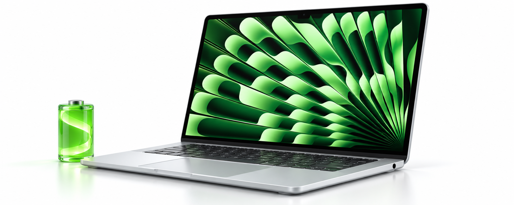
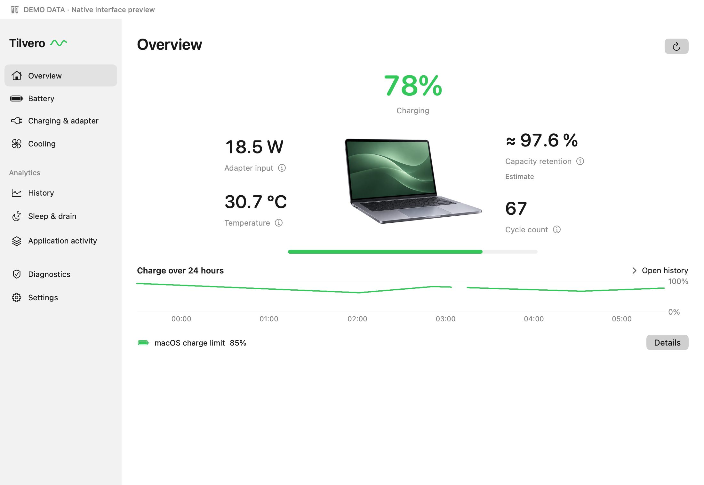
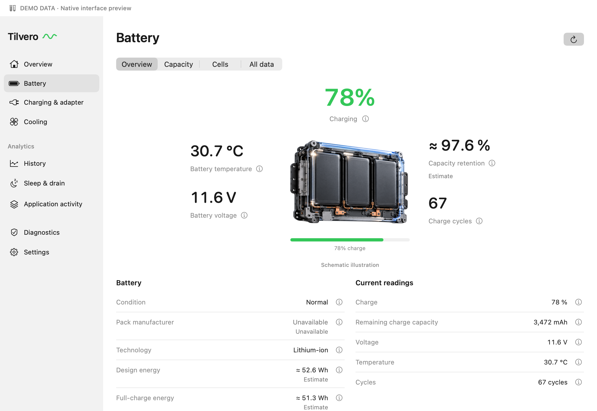
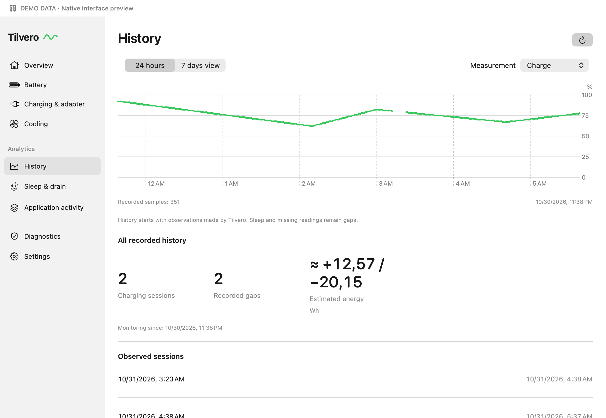
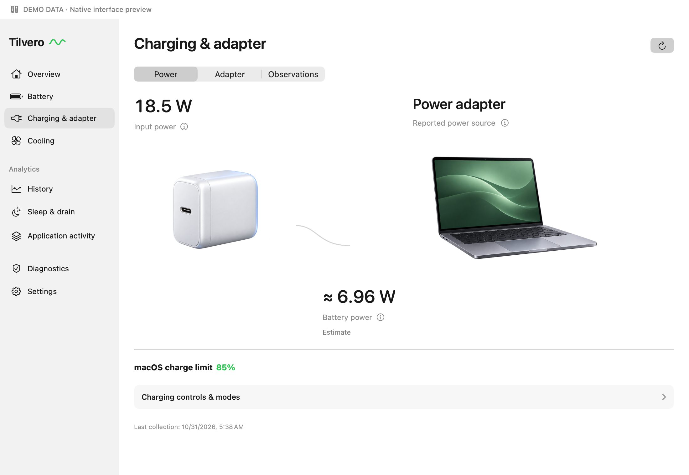

<p align="center">
  
</p>

<h1 align="center">Tilvero</h1>
<p align="center"><strong>Your Mac’s battery, power and activity. In view.</strong></p>
<p align="center">Native Swift for macOS · Apple silicon · Works offline</p>
<p align="center"><strong>English</strong> · <a href="README.ru.md">Русский</a></p>



<sub>Generated product illustration; native interface captures appear below. [Artwork provenance](.github/assets/COVER_PROMPT.md).</sub>

Tilvero puts battery and power information in your menu bar, with a clear native
window when you want the details. Follow charging, inspect battery health and
understand changes over time, without an account or a cloud service.

**Source preview for developers.**
[Get the source](https://github.com/RaNDoM6913/Tilvero/releases/download/v0.1.0-beta.1/Tilvero-0.1.0-beta.1-source.zip)
· [Release notes and checksums](https://github.com/RaNDoM6913/Tilvero/releases/tag/v0.1.0-beta.1)
· [Build and run](#build-and-run) · [Roadmap](ROADMAP.md)

A signed, notarized Mac download is still in preparation. The planned
**Monitoring Preview** DMG will be read-only; this repository also contains
separately gated development controls. [Availability and installation](docs/INSTALL.md).

## A closer look at your Mac

| See | What Tilvero shows |
| --- | --- |
| Battery at a glance | Menu bar charge, power source and a compact panel with configurable blocks and indicator sizing |
| Battery health | Available capacity, temperature, cycle and cell readings, with measurement sources and freshness |
| Power and charging | Battery power, reported system load and adapter input/capability kept distinct; system charge-limit readback |
| Application activity | Searchable process activity, CPU load, CPU energy/power estimates, wakeups and disk I/O, with partial coverage made visible |
| History and reports | Local charts, minute samples, hourly summaries and previewable CSV/JSON exports; gaps stay visible |
| Sleep & drain | App-observed sleep/wake intervals and current sleep blockers, with incomplete evidence clearly marked |
| A panel that fits | Rearrange or hide blocks, choose Russian or English, and adjust menu bar text and icon size |

The catalog describes **115 fields**. Your Mac determines which are available;
missing values stay unavailable. Monitoring needs no administrator approval.

## Inside Tilvero

Native interface rendered from source with injected demo data. Illustrations
are schematic; these captures do not establish hardware support or qualify a
release binary.

<table>
  <tr>
    <td width="50%"><strong>Overview</strong><br><a href=".github/assets/screenshots/overview.png"></a></td>
    <td width="50%"><strong>Battery</strong><br><a href=".github/assets/screenshots/battery.png"></a></td>
  </tr>
  <tr>
    <td width="50%"><strong>History</strong><br><a href=".github/assets/screenshots/history.png"></a></td>
    <td width="50%"><strong>Charging</strong><br><a href=".github/assets/screenshots/charging.png"></a></td>
  </tr>
</table>

## Build and run

You need **Apple silicon, macOS 26.0+ and a full Xcode installation** with a
compatible macOS SDK and Swift 6. Command Line Tools alone are not the validated route.

```sh
git clone https://github.com/RaNDoM6913/Tilvero.git
cd Tilvero
bash scripts/test.sh
bash scripts/build-local-app.sh
bash scripts/run-local.sh
```

The app opens in the menu bar. Click the battery item for the quick panel;
**History & reports…** opens the detail window, and the gear opens Settings.
Inside Tilvero, **⌘⌥B** toggles the panel and **⌘,** opens Settings.

The local bundle is ad-hoc signed for development. The builder preserves a
running copy; use a fresh destination when keeping an existing build:

```sh
bash scripts/build-local-app.sh --output build/dev-candidates.noindex/my-build/Tilvero.app
```

That destination must not exist. Run one development copy at a time.
[Installation and updates](docs/INSTALL.md) explains data locations and the future DMG route.

## Preview boundaries

**Application power is a CPU estimate.** It does not measure an app’s total
electrical consumption across CPU, GPU and other devices. Live macOS Energy
Impact is not implemented. Values never become zero merely because access is denied.

**Sleep reports start with observed events.** Tilvero does not reconstruct past
nights from sample gaps or attribute their energy use to individual apps.

**Controls have separate admission.** Development source includes Keep Mac Awake,
saved modes and a native charge controller. Saving a plan does not apply it.
Native charge changes require a local per-Mac setting/readback/restoration check;
one-time full charging has an additional gate. Privileged charging, power-mode
and fan writes remain unqualified. Fans default to System Auto.

The future Monitoring Preview configuration disables Keep Mac Awake and control
actions and contains no privileged helper. A default source build is a development
build with its own gates. Simulation is explicitly marked **DEMO** and stays
separate from live history. See [compatibility](docs/COMPATIBILITY.md) and the
[control architecture](Helper/README.md) for exact boundaries.

## Your data stays on your Mac

No account, cloud service or telemetry upload. Battery history is stored locally;
detailed records default to 30 days and hourly summaries to up to 365 days.
Settings let you shorten detailed retention or erase history.

Process identity stays in memory and is excluded from battery history and
ordinary diagnostics exports. Normal presentation masks serials and identity
tokens. Preview reports before choosing to share them.

## Help shape Tilvero

- [Report a bug or suggest an improvement](https://github.com/RaNDoM6913/Tilvero/issues/new/choose)
- [Contributing](CONTRIBUTING.md) — setup, module boundaries and safe verification
- [Changelog](CHANGELOG.md) · [Roadmap](ROADMAP.md) · [Compatibility](docs/COMPATIBILITY.md)
- [Release preparation](docs/RELEASING.md) · [Testing and validation](docs/TESTING.md)

Please include your Mac model, macOS version and source version with a bug report.
Review diagnostics for personal data before attaching them.

## License

Copyright © 2026 [RaNDoM6913](https://github.com/RaNDoM6913).
Original Tilvero source, documentation and repository artwork use
[GNU GPL version 3 only](LICENSE) (`GPL-3.0-only`). Preserve copyright and license
notices when redistributing; distributed derivatives must satisfy the GPL’s
source and same-license requirements.

Third-party materials retain their own notices:
[COPYRIGHT](COPYRIGHT) · [Third-party notices](THIRD_PARTY_NOTICES.md).
