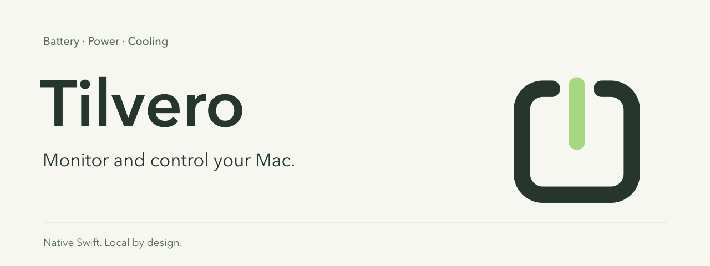

<p align="center">
  
</p>

<p align="center"><strong>English</strong> · <a href="README.ru.md">Русский</a></p>

<p align="center">
  
  
  
  
  <a href="LICENSE"></a>
</p>

# Tilvero

**Monitor and control your Mac.** A native Swift menu bar utility for battery, charging, power and cooling. Local data, a compact panel and an honest view of what your Mac can report.

**Monitoring Preview:** live monitoring, history and diagnostics work in the current local source build. Physical charging, power and fan controls remain disabled pending trusted signing and device qualification.

## Get Tilvero

**No public DMG is available yet.** [Build from source](#build-and-run) on Apple silicon with macOS 26.0+. The [installation guide / инструкция по установке](docs/INSTALL.md) explains the planned three-step installation and manual updates when a trusted release is available.

Local **TEST** packages are internal ad-hoc builds. They are not a signed, notarized public download. This page will gain one Download for Mac link, version, size and matching checksums only after the exact release artifact passes distribution checks and the owner publishes it.

## What works today

| Capability | Current behavior |
| --- | --- |
| Live battery monitoring | Charge, power-source status and available battery readings, with source, freshness and unavailable reasons |
| Menu bar and detail window | Content-sized Overview / Charge / Modes panel, direct qualified charge actions, searchable detail readings, Russian/English and adjustable indicator sizing |
| Local history | Minute samples, hourly aggregates, gaps and battery boundaries; CSV/JSON preview and export |
| Sleep & drain | Separate detail section for future app-observed sleep intervals, qualified before/after charge change and current sleep blockers; incomplete evidence stays visible |
| Diagnostics | Read-only discovery and a redacted report; no administrator approval needed for monitoring |
| Explicit demo mode | Clearly marked simulated readings and control policies, kept separate from live history |

The normal battery silhouette is calibrated to a system reference; the custom percentage-inside option uses a lower iOS-inspired body with larger adaptive numerals. Unknown values and the adapter cue remain distinct from measured charge.

The catalog defines **100 fields**. Availability depends on the Mac and macOS; it does not mean every device exposes 100 readings. Missing data stays unavailable.

Sleep reports begin with a sleep/wake interval observed while Tilvero is running and history is enabled. They are not backfilled from old sample gaps. The measured charge change spans the recorded observations; it does not prove battery-only operation or exact time asleep. Current process assertions explain what may prevent sleep **now**, not which application consumed energy during an earlier night. Internal wake counts, wake reasons and per-app energy are unavailable from this collection. Sleep records follow the selected detailed-history period, are erased with history, and are not included in the ordinary CSV/JSON export. Process names and assertion descriptions are not persisted.

## Build and run

These are developer source-build commands. A future Monitoring Preview DMG is helper-free; installed-app users will not need Xcode or helper discovery commands.

Requires **Apple silicon, macOS 26.0+ and a compatible full Xcode installation** with Swift 6 support. The scripts select `/Applications/Xcode.app/Contents/Developer` per process when available, without changing the system's Xcode selection.

From the repository directory:

```sh
bash scripts/test.sh
bash scripts/build-local-app.sh
open build/Tilvero.app
```

To preserve an existing development bundle, build into a fresh location with `bash scripts/build-local-app.sh --output build/dev-candidates/my-build/Tilvero.app`. The explicit output must not exist. `TilveroApp --sleep-status` is a read-only status check that omits process names and does not start migration or the app UI.

The app starts in the menu bar. Click the battery item to open the quick panel, then **Battery Info** for the detail window. Reopen Tilvero to restore the window if its menu item is hidden. In the app, **⌘⌥B** toggles the panel and **⌘,** opens Settings.

Settings offer icon only or percentage beside/inside the icon, System/Larger text, independent icon scale from 85–115%, reset, Russian/English and history preferences.

For the separate Xcode app/helper targets:

```sh
bash scripts/build-xcode.sh
open build/Xcode/Build/Products/Debug/Tilvero.app
```

Run one build at a time: both bundles share the development app identifier. Local ad-hoc signing verifies bundle integrity; it does not provide trusted helper enrollment or notarization.

## Diagnostics and demo

The helper discovery command below belongs only to the development bundle, not the helper-free Monitoring Preview package.

```sh
build/Tilvero.app/Contents/MacOS/TilveroApp --doctor
build/Tilvero.app/Contents/Library/HelperTools/TilveroHelper --discover
```

Discovery is read-only. Review diagnostic content before sharing it. Quit the live app before launching the simulator:

```sh
open build/Tilvero.app --args --demo
```

**DEMO** appears in the menu bar. Simulation exercises charging intent, pending lower targets, one-shot full charge, fan policies and schedules. Slider changes remain drafts until Apply. Demo behavior is not evidence of physical hardware support.

## Private by design

Tilvero runs without an account, cloud service or telemetry upload. History stays in `~/Library/Application Support/Tilvero/History.sqlite`. Default retention is 30 days for detailed samples and up to 365 days for hourly aggregates; Settings can shorten detailed retention or erase all history.

Normal presentation masks serials and identity tokens; ordinary exports exclude them. Diagnostics can be previewed before saving. Local diagnostic files and exports are yours to review and share deliberately.

## Hardware controls: current boundary

The source includes typed backends, authenticated XPC, original-state journals and a separate recovery guardian. Charging policies, power profiles and fan control have source and fixture coverage, but the **physical-write qualification list is empty**. No helper enrollment or live control support is claimed for this preview.

Enabling a control requires trusted app/helper signing, normal macOS authorization, demonstrated per-device behavior and verified restoration. Cooling also needs a real MacBook Pro and a qualified sensor mapping. A readable key or model name alone does not establish write support. Do not register the development helper to bypass these gates.

Requested, applied and observed state remain separate. A lower charge target may stay visibly pending until natural discharge; fan policies default to System Auto. See the [control architecture](Helper/README.md) and [compatibility and validation gates](docs/COMPATIBILITY.md).

## Next directions

The first read-only sleep-report stage is implemented. Economy/Maximum autonomy, quiet-sleep control and charging for a departure time remain proposed work in the [roadmap](ROADMAP.md), awaiting their own scope and qualification. No fixed battery-life saving or asleep charging deadline is promised.

## Development

Earlier monitoring software validation recorded **123 passing tests** and successful local/Xcode builds. This is historical local evidence, separate from new release preparation, signed-runtime and real-device control acceptance; see [compatibility and evidence boundaries](docs/COMPATIBILITY.md).

- [Contributing](CONTRIBUTING.md) — setup, code boundaries and safe verification
- [Compatibility](docs/COMPATIBILITY.md) · [Roadmap](ROADMAP.md)
- [Install and update](docs/INSTALL.md) · [Changelog](CHANGELOG.md)
- [Release and download preparation](docs/RELEASING.md) — DMG, signing and on-demand download counts
- [Report a problem](https://github.com/RaNDoM6913/Tilvero/issues/new/choose) — review and redact diagnostics before sharing
- [Control architecture](Helper/README.md)
- [Third-party notices](THIRD_PARTY_NOTICES.md)

## License and authorship

Copyright © 2026 [RaNDoM6913](https://github.com/RaNDoM6913). Tilvero's original source, documentation and repository artwork are licensed under [GNU GPL version 3 only](LICENSE) (`GPL-3.0-only`). You may use, modify and redistribute them under those terms, preserving the copyright and license notices. Distributed derivative works must meet the GPL source and same-license requirements.

Third-party material keeps its respective authorship and notices; see [COPYRIGHT](COPYRIGHT) and [third-party notices](THIRD_PARTY_NOTICES.md).
