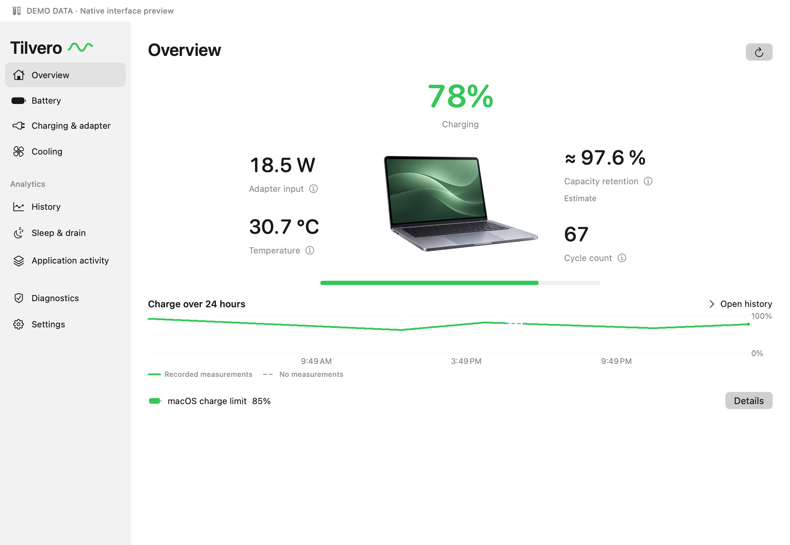
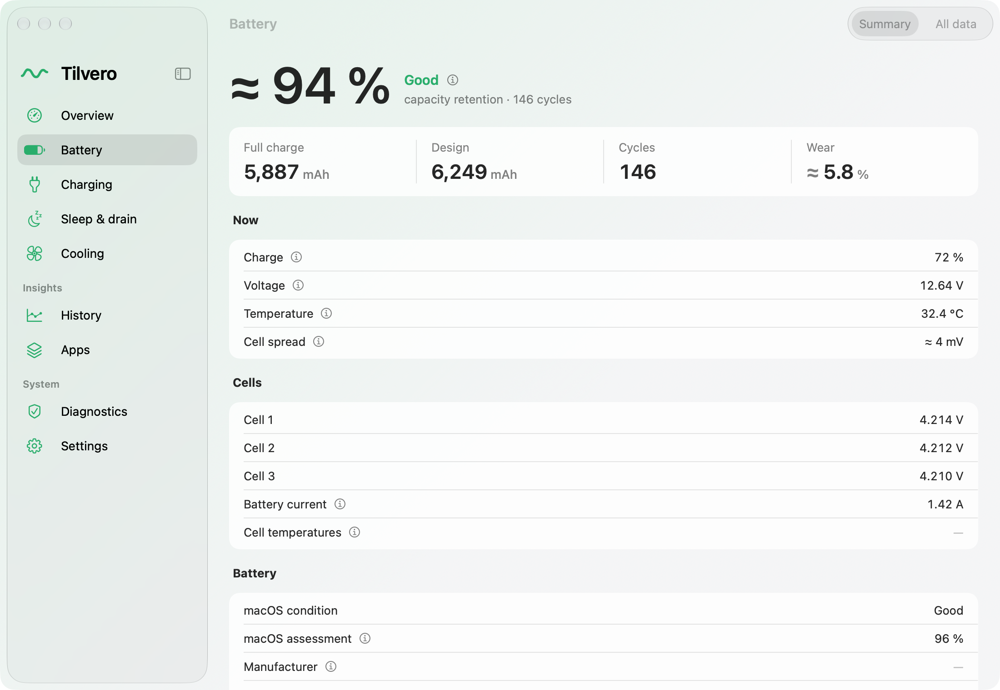
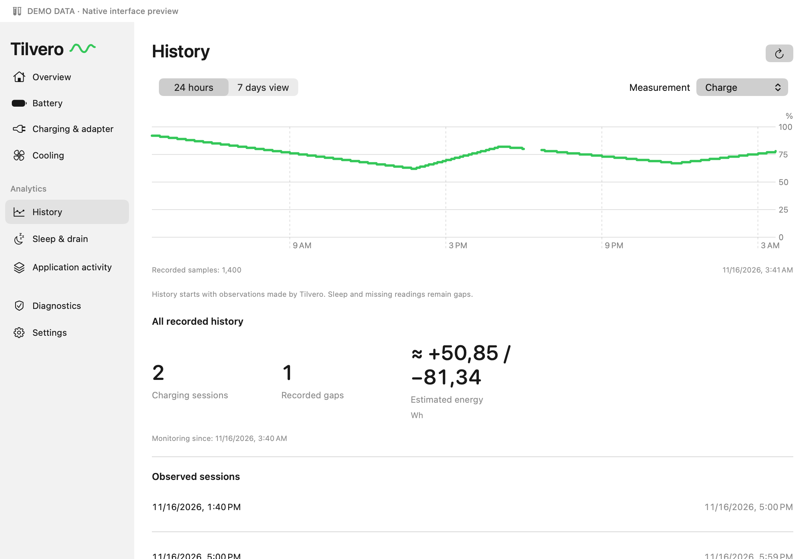

<p align="center">
  <a href="https://github.com/RaNDoM6913/Tilvero/releases/tag/v0.7.1"></a>
  <a href="docs/GITHUB_TRAFFIC.md"></a>
  <a href="LICENSE"></a>
</p>

<p align="center"><strong>English</strong> · <a href="README.ru.md">Русский</a></p>

Tilvero lives in your menu bar. One quick menu shows your battery and power,
keeps your Mac awake or sleeps it on a timer, and sets the macOS charge limit,
with a clear native window when you want the details. No account, no cloud service.


<sub>Overview · Sleep timer · Keep Awake with the Screen and sound row · Charge. Rendered from source with injected demo readings; they do not
establish hardware support or qualify a release binary.</sub>

## What the quick menu does

- **Overview:** the battery level and state, the macOS charge limit at a glance, Keep Awake in one tap, and live
  charts for power (adapter and battery in one chart) and temperature with battery health below. Blocks, order and chart size are yours to arrange.
- **Sleep:** a sleep timer you can extend by 5 minutes, 15 minutes or an hour; Keep Awake for a set time or until you stop it,
  with an optional **With lid closed** switch that also turns the screen down and caps the volume while the lid is shut; and
  sleep or keep awake when the charge falls to a level you choose.
- **Charge:** the macOS charge limit (80–100 %), a one-time charge to 100 %, and **charge by time**: pick a time and a level
  and Tilvero lifts the limit just in time, waking a sleeping Mac on schedule (one optional administrator permission;
  waking with the lid closed is still being verified on real hardware).
- **First run:** a brand-new install opens one setup window (launch at login, history, the closed-lid option and charge by time).
  Existing installs never see it.

**Latest: [0.7.1 Source Preview](https://github.com/RaNDoM6913/Tilvero/releases/tag/v0.7.1) for developers.**
[Get the source](https://github.com/RaNDoM6913/Tilvero/releases/download/v0.7.1/Tilvero-0.7.1-source.zip)
· [Release notes and checksums](https://github.com/RaNDoM6913/Tilvero/releases/tag/v0.7.1)
· [Build and run](#build-and-run) · [Roadmap](ROADMAP.md)
· Earlier: [0.7.0](https://github.com/RaNDoM6913/Tilvero/releases/tag/v0.7.0),
[0.6.2](https://github.com/RaNDoM6913/Tilvero/releases/tag/v0.6.2)

A signed, notarized Mac download is still in preparation. The planned
**Monitoring Preview** DMG will be read-only; this repository also contains
separately gated development controls. [Availability and installation](docs/INSTALL.md).

## What's new in 0.7.1

A polish release: a clearer battery-health card and a quiet update notice.

**New**
- **A "New version" notice in the quick menu.** When the last update check found a release newer than your build, a wide capsule appears in the header between the name and the gear and opens Settings > Updates. It only informs.
- **Update checks are on by default.** Tilvero asks GitHub once a day while it runs (the first time about two minutes after launch). It is one public request: no account, no readings sent. Turn it off in Settings > Updates. Installing is still manual: a release publishes source, which you build with Xcode; nothing is downloaded or installed for you.

**Changed**
- **The battery-health card on the Overview shows the cycle count and the wear on a larger line**, with the capacities small below.
- The Updates page keeps showing the dated result of the last successful check, even when a later check fails or is cancelled.

**Fixed**
- The Keep Awake and Sleep timer switch animates again; it was rebuilt in the middle of the click.

## What was new in 0.7.0

A first-run setup for new installs, a starter Overview with Keep Awake, power, temperature and battery health, and one title style for every Overview block.

Full history: [CHANGELOG](CHANGELOG.md).

## More than the menu: a closer look at your Mac

| See | What Tilvero shows |
| --- | --- |
| Battery at a glance | Menu bar charge, power source and a compact panel with configurable blocks and indicator sizing |
| Battery health | Available capacity, temperature, cycle and cell readings, with measurement sources and freshness |
| Power and charging | Battery power, reported system load and adapter input/capability kept distinct; system charge-limit readback |
| Application activity | Searchable process activity, CPU load, CPU energy/power estimates, wakeups and disk I/O, with partial coverage made visible |
| History and reports | Local charts, minute samples, hourly summaries and previewable CSV/JSON exports; gaps stay visible |
| Sleep & drain | App-observed sleep/wake intervals and current sleep blockers, with incomplete evidence clearly marked |
| A panel that fits | Rearrange or hide blocks, choose Russian or English, and adjust menu bar text and icon size |

The catalog describes **115 fields**. Your Mac determines which are available;
missing values stay unavailable. Monitoring needs no administrator approval.

## The detail window

Native interface rendered from source with injected demo data. Illustrations
are schematic; these captures do not establish hardware support or qualify a
release binary.

<table>
  <tr>
    <td width="50%"><strong>Overview</strong><br><a href=".github/assets/screenshots/overview.png"></a></td>
    <td width="50%"><strong>Battery</strong><br><a href=".github/assets/screenshots/battery.png"></a></td>
  </tr>
  <tr>
    <td width="50%"><strong>History</strong><br><a href=".github/assets/screenshots/history.png"></a></td>
    <td width="50%"><strong>Charging</strong><br><a href=".github/assets/screenshots/charging.png"></a></td>
  </tr>
</table>

## Build and run

You need **Apple silicon, macOS 26.0+ and a full Xcode installation** with a
compatible macOS SDK and Swift 6. Command Line Tools alone are not the validated route.

```sh
git clone --branch v0.7.1 https://github.com/RaNDoM6913/Tilvero.git
cd Tilvero
bash scripts/test.sh
bash scripts/build-local-app.sh
bash scripts/run-local.sh
```

The app opens in the menu bar; a brand-new install opens its first-run setup window first. Click the battery item for the quick menu;
**History & reports…** opens the detail window, and the gear opens Settings.
Inside Tilvero, **⌘⌥B** toggles the panel and **⌘,** opens Settings.

The local bundle is ad-hoc signed for development. The builder preserves a
running copy; use a fresh destination when keeping an existing build:

```sh
bash scripts/build-local-app.sh --output build/dev-candidates.noindex/my-build/Tilvero.app
```

That destination must not exist. Run one development copy at a time.
[Installation and updates](docs/INSTALL.md) explains data locations and the future DMG route.

## Preview boundaries

**Application power is a CPU estimate.** It does not measure an app’s total
electrical consumption across CPU, GPU and other devices. Live macOS Energy
Impact is not implemented. Values never become zero merely because access is denied.

**Sleep reports start with observed events.** Tilvero does not reconstruct past
nights from sample gaps or attribute their energy use to individual apps.

**Controls have separate admission.** Development source includes Keep Mac Awake,
the sleep timer, saved modes and a native charge controller. Saving a plan does not apply it.
The charge limit, the one-time full charge and charge by time use the macOS charge setting and
a local per-Mac setting/readback/restoration check; your own limit wins over any plan.
Charge by time can ask for one optional administrator permission (`pmset schedule wake`)
to wake a sleeping Mac; on-device wake behaviour, with the lid closed as well, is still unverified.
Privileged charging, power-mode and fan writes remain unqualified. Fans default to System Auto.

The future Monitoring Preview configuration disables Keep Mac Awake and control
actions and contains no privileged helper. A default source build is a development
build with its own gates. Simulation is explicitly marked **DEMO** and stays
separate from live history. See [compatibility](docs/COMPATIBILITY.md) and the
[control architecture](Helper/README.md) for exact boundaries.

## Your data stays on your Mac

No account, cloud service or telemetry upload. Battery history is stored locally;
detailed records default to 30 days and hourly summaries to up to 365 days.
Settings let you shorten detailed retention or erase history.

Process identity stays in memory and is excluded from battery history and
ordinary diagnostics exports. Normal presentation masks serials and identity
tokens. Preview reports before choosing to share them.

## Help shape Tilvero

- [Report a bug or suggest an improvement](https://github.com/RaNDoM6913/Tilvero/issues/new/choose)
- [Contributing](CONTRIBUTING.md) — setup, module boundaries and safe verification
- [Changelog](CHANGELOG.md) · [Roadmap](ROADMAP.md) · [Compatibility](docs/COMPATIBILITY.md)
- [Release preparation](docs/RELEASING.md) · [Testing and validation](docs/TESTING.md)

Please include your Mac model, macOS version and source version with a bug report.
Review diagnostics for personal data before attaching them.

## License

Copyright © 2026 [RaNDoM6913](https://github.com/RaNDoM6913).
Original Tilvero source, documentation and repository artwork use
[GNU GPL version 3 only](LICENSE) (`GPL-3.0-only`). Preserve copyright and license
notices when redistributing; distributed derivatives must satisfy the GPL’s
source and same-license requirements.

Third-party materials retain their own notices:
[COPYRIGHT](COPYRIGHT) · [Third-party notices](THIRD_PARTY_NOTICES.md).

Artwork: [banner generation record](.github/assets/COVER_PROMPT.md).
