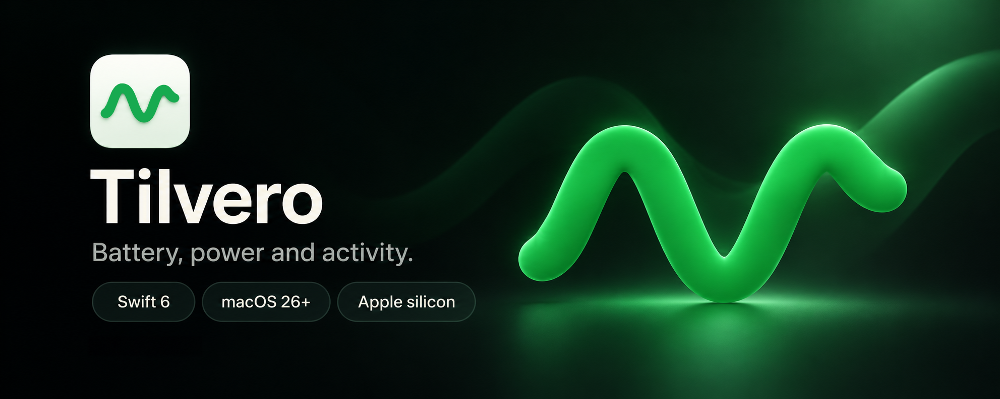
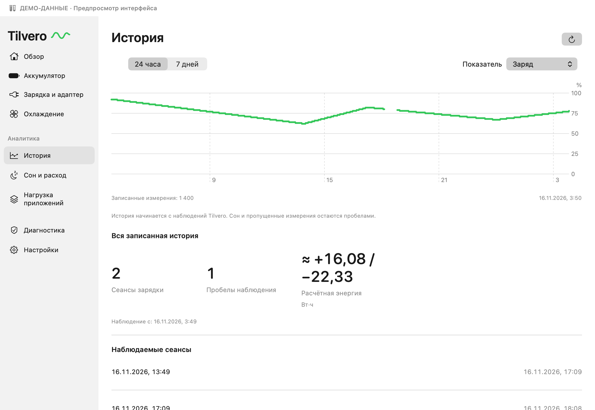
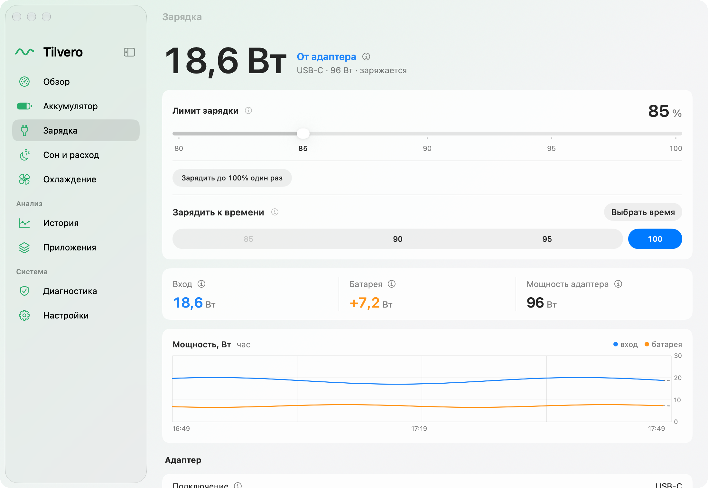

<p align="center">
  <a href="https://github.com/RaNDoM6913/Tilvero/releases/latest"></a>
  <a href="docs/GITHUB_TRAFFIC.md"></a>
  <a href="LICENSE"></a>
</p>

<p align="center"><a href="README.md">English</a> · <strong>Русский</strong></p>

Tilvero живёт в строке меню. Одно быстрое меню показывает батарею и питание,
не даёт Mac уснуть или усыпляет его по таймеру и задаёт лимит зарядки macOS,
а подробности — в удобном нативном окне. Без аккаунта и облачного сервиса.


<sub>Обзор · Таймер сна · Не засыпать со строкой «Экран и звук» · Заряд. Отрисовано из исходников с подставленными тестовыми показаниями;
они не подтверждают поддержку аппаратного управления и не квалифицируют релизное приложение.</sub>

## Что умеет быстрое меню

- **Обзор:** заряд и состояние батареи, лимит зарядки macOS одним взглядом, «Не засыпать» в одно нажатие
  и живые графики мощности (адаптер и батарея на одном графике) и температуры; ниже карточка сохранения ёмкости (циклы, износ и ёмкости).
  Блоки, порядок и размер графиков настраиваются; кнопки длительности и уровня в разделе «Сон» можно изменить в Настройки > Быстрое меню.
- **Сон:** таймер сна, который можно продлить на 5 минут, 15 минут или час; «Не засыпать» на время или пока вы не остановите,
  с необязательным переключателем **«С закрытой крышкой»**, который заодно приглушает экран и ограничивает громкость, пока крышка закрыта;
  сон или «не засыпать» при падении заряда до выбранного уровня.
- **Заряд:** лимит зарядки macOS (80–100 %), разовая зарядка до 100 % и **зарядка к времени**: выберите время и уровень,
  и Tilvero поднимет лимит как раз вовремя, разбудив спящий Mac по расписанию (одно необязательное разрешение администратора;
  пробуждение с закрытой крышкой ещё проверяется на реальном железе).
- **Первый запуск:** на совсем новой установке открывается одно окно настройки (запуск при входе, история, режим закрытой крышки
  и «Зарядить к времени»). Уже установленные копии его не показывают.

**Новейшая версия: [исходники 0.8.0](https://github.com/RaNDoM6913/Tilvero/releases/tag/v0.8.0) для разработчиков.**
[Получить исходники](https://github.com/RaNDoM6913/Tilvero/releases/download/v0.8.0/Tilvero-0.8.0-source.zip)
· [Описание выпуска и контрольные суммы](https://github.com/RaNDoM6913/Tilvero/releases/tag/v0.8.0)
· [Сборка и запуск](#сборка-и-запуск) · [План развития](ROADMAP.md)
· Ранее: [0.7.1](https://github.com/RaNDoM6913/Tilvero/releases/tag/v0.7.1),
[0.7.0](https://github.com/RaNDoM6913/Tilvero/releases/tag/v0.7.0)

Подписанная и нотарифицированная версия для Mac готовится. Планируемый DMG
**Monitoring Preview** будет работать только для чтения; в репозитории также
есть управление для разработки с отдельными проверками допуска.
[Доступность и установка](docs/INSTALL.md#русский).

## Что нового в 0.8.0

Переработанное главное окно, более безопасный режим **«С закрытой крышкой»** и обновлённое, более быстрое хранилище истории.

**Новое**
- **Переработанное главное окно.** Стеклянная боковая колонка со страницами «Обзор», «Аккумулятор», «Зарядка», «Сон и расход», «Охлаждение», «История», «Приложения», «Диагностика» и «Настройки»; по **⌃⌘S** она сужается до полосы значков (выбор запоминается). У страниц с несколькими видами («Аккумулятор», «Сон и расход», «Настройки») вкладки стоят в панели инструментов. Страница «Зарядка» объединяет лимит зарядки, разовую зарядку до 100 % и «Зарядить к времени» с графиком мощности и показаниями адаптера. Страница «Приложения» показывает активность процессов, а «Диагностика» стала аккуратнее.
- **Редактируемые кнопки быстрого меню.** В Настройки > Быстрое меню можно изменить кнопки длительности и уровня для таймера сна, «Не засыпать», «Сна при заряде» и «Не засыпать до заряда».
- **Страж для «С закрытой крышкой».** Переключатель меняет общесистемную настройку сна, которая переживает приложение. Теперь каждая сессия запускает небольшой вспомогательный процесс (вторую копию приложения) и записывает на диск метку. Если Tilvero упал, был принудительно закрыт или убит, этот процесс возвращает обычный сон, но только пока метка всё ещё его. Он умеет вернуть сон, но не умеет его отключить.
- **Разовая очистка старого остатка.** До 0.7.1 включительно запуск, завершившийся без восстановления, мог оставить сон отключённым. При первом запуске 0.8.0 Tilvero сбрасывает это, только если включён переключатель «С закрытой крышкой» и установлено собственное беспарольное правило Tilvero, без запроса пароля. Без таких признаков он ничего не трогает, а обычное предупреждение остаётся.
- **Мощность батареи вживую раз в секунду**, пока на экране живой график (читается из SMC), вместо значения реестра раз в минуту.
- **Новая иконка приложения и баннер.**

**Изменено**
- **Карточка сохранения ёмкости показывает циклы и износ в одной строке**, а ёмкости мелким шрифтом рядом.
- **Легенда графика мощности с цветными значками**, а показания обычным цветом текста.
- **Хранилище истории обновлено до схемы 3:** загружается быстрее и больше не работает в главном потоке, у него есть ограничение размера (512 МБ, видно в Настройки > История). Перед обновлением старого хранилища Tilvero делает закрытую копию `History.pre-v3.sqlite` (хранится 30 дней); если копию сделать не удалось, обновление откладывается до следующего запуска. `scripts/restore-history-backup.sh` возвращает копию при откате ([подробнее](docs/INSTALL.md#русский)).
- **Меньше фоновой работы:** процессы сканируются примерно раз в две минуты, пока их не показывает ни одна панель, таймер «Зарядить к времени» работает, только пока есть план, лимит зарядки читается один раз за опрос, а закрытое быстрое меню ничего не измеряет.

**Исправлено**
- Сообщения помощника переведены (русская страница показывала английский), ошибки истории читаются как предложения, а «Вернуть сон» больше не стоит под надписью «Tilvero её не изменит».

**Известные ограничения.** Новое окно видели только на macOS 27.2, на macOS 26 ещё нет. На реальном Mac пока не проверены: знак мощности батареи вживую при зарядке от сети, страж крышки после настоящего принудительного закрытия подписанной сборки и пробуждение спящего Mac для «Зарядить к времени».

## Что было нового в 0.7.1

Доводка: более понятная карточка здоровья батареи и тихое уведомление об обновлении.

Вся история: [CHANGELOG](CHANGELOG.md).

## Не только меню: Ваш Mac в подробностях

| Раздел | Что показывает Tilvero |
| --- | --- |
| Батарея одним взглядом | Заряд и источник питания в строке меню; компактная панель с настройкой блоков и размера индикатора |
| Состояние батареи | Доступные ёмкость, температура, циклы и данные ячеек с источниками и временем измерения |
| Питание и зарядка | Раздельные мощность батареи, системная нагрузка и вход/возможности адаптера; чтение системного лимита зарядки |
| Приложения | Поиск процессов, нагрузка CPU, оценки энергии/мощности CPU, пробуждения и дисковый ввод-вывод с явным указанием неполных данных |
| История и отчёты | Локальные графики, минутные записи, часовые сводки и экспорт CSV/JSON с предпросмотром; разрывы остаются видимыми |
| Сон и разряд | Наблюдавшиеся приложением сон и пробуждение, текущие препятствия сну и явные отметки неполных данных |
| Удобная панель | Порядок и видимость блоков, русский и английский языки, размер значка и текста в строке меню |

Каталог описывает **115 полей**. Их доступность зависит от конкретного Mac;
отсутствующие показания остаются недоступными. Мониторингу не нужны права администратора.

## Главное окно

**«История и отчёты…»** открывает главное окно: стеклянную боковую колонку (она сужается до полосы значков) и девять страниц.
Нативный интерфейс отрисован из исходников с подставленными тестовыми показаниями на временном хранилище истории, это не данные реального Mac.
Эти снимки не подтверждают поддержку аппаратного управления или квалификацию релизного приложения.

<table>
  <tr>
    <td width="50%"><strong>Обзор</strong><br><a href=".github/assets/screenshots/ru/overview.png"></a></td>
    <td width="50%"><strong>Батарея</strong><br><a href=".github/assets/screenshots/ru/battery.png"></a></td>
  </tr>
  <tr>
    <td width="50%"><strong>История</strong><br><a href=".github/assets/screenshots/ru/history.png"></a></td>
    <td width="50%"><strong>Зарядка</strong><br><a href=".github/assets/screenshots/ru/charging.png"></a></td>
  </tr>
</table>

## Сборка и запуск

Нужны **Mac с Apple silicon, macOS 26.0+ и полная установка Xcode** с совместимым
macOS SDK и Swift 6. Отдельные Command Line Tools не являются проверенным путём сборки.

```sh
git clone --branch v0.8.0 https://github.com/RaNDoM6913/Tilvero.git
cd Tilvero
bash scripts/test.sh
bash scripts/build-local-app.sh
bash scripts/run-local.sh
```

Приложение открывается в строке меню; на совсем новой установке сначала появляется окно первого запуска. Нажмите на значок батареи для быстрого меню;
**«История и отчёты…»** открывает главное окно, шестерёнка — настройки.
В Tilvero сочетание **⌘⌥B** переключает панель, **⌘,** открывает настройки.

Локальная сборка подписывается ad-hoc для разработки. Сборщик сохраняет работающую
копию; чтобы оставить существующую сборку, укажите новый каталог:

```sh
bash scripts/build-local-app.sh --output build/dev-candidates.noindex/my-build/Tilvero.app
```

Указанный путь не должен существовать. Запускайте одну копию для разработки.
[Установка и обновление](docs/INSTALL.md#русский) описывает хранение данных и будущий DMG.

## Границы предварительной версии

**Мощность приложения — оценка для CPU.** Полное электрическое потребление
приложения с учётом GPU и других устройств не измеряется. Получение текущего
Energy Impact macOS не реализовано. Закрытый доступ не превращает значение в ноль.

**Отчёты сна начинаются с наблюдавшихся событий.** Tilvero не восстанавливает
прошлые ночи по разрывам истории и не приписывает их расход отдельным приложениям.

**Управление требует отдельного допуска.** В исходниках есть «Не давать Mac
уснуть», таймер сна, сохраняемые режимы и нативный контроллер зарядки. Сохранение
режима не применяет его. Лимит зарядки, разовая полная зарядка и зарядка к времени
используют настройку зарядки macOS и локальную проверку записи, чтения и восстановления
на конкретном Mac; ваш собственный лимит всегда важнее любого плана. Зарядка к времени
может запросить одно необязательное разрешение администратора (`pmset schedule wake`),
чтобы разбудить спящий Mac; поведение пробуждения на реальном устройстве, в том числе
с закрытой крышкой, ещё не проверено.
Привилегированная запись зарядки, режимов питания и вентиляторов пока не квалифицирована.
Вентиляторы по умолчанию остаются под управлением системы.

Будущая конфигурация Monitoring Preview отключает предотвращение сна и действия
управления и не содержит привилегированного помощника. Обычная сборка исходников —
версия для разработки со своими проверками допуска. Симуляция явно помечена
**DEMO** и отделена от реальной истории. Подробности:
[совместимость](docs/COMPATIBILITY.md) и [архитектура управления](Helper/README.md).

## Данные остаются на Mac

Без аккаунта, облака и отправки телеметрии. История батареи хранится локально;
по умолчанию подробные записи сохраняются 30 дней, часовые сводки — до 365 дней.
В настройках можно сократить срок подробной истории или удалить её.

Идентификация процессов остаётся в памяти и исключена из истории батареи
и обычного диагностического экспорта. Серийные номера и идентификационные токены
скрыты в обычном интерфейсе. Просмотрите отчёт перед тем, как поделиться им.

## Помогите улучшить Tilvero

- [Сообщить об ошибке или предложить улучшение](https://github.com/RaNDoM6913/Tilvero/issues/new/choose)
- [Участие в разработке](CONTRIBUTING.md) — подготовка, модули и безопасные проверки
- [История изменений](CHANGELOG.md) · [План развития](ROADMAP.md) · [Совместимость](docs/COMPATIBILITY.md)
- [Подготовка выпуска](docs/RELEASING.md) · [Тестирование и проверки](docs/TESTING.md)

В сообщении об ошибке укажите модель Mac, версию macOS и версию исходников.
Перед приложением диагностики проверьте её на личные данные.

## Лицензия

Авторские права © 2026 [RaNDoM6913](https://github.com/RaNDoM6913).
Оригинальные исходники Tilvero, документация и графика репозитория используют
[GNU GPL только версии 3](LICENSE) (`GPL-3.0-only`). Сохраняйте уведомления
об авторстве и лицензии; при распространении производных работ выполняйте
требования GPL к исходному коду и той же лицензии.

Сторонние материалы сохраняют собственные уведомления:
[COPYRIGHT](COPYRIGHT) · [Сторонние материалы](THIRD_PARTY_NOTICES.md).

Оформление: [происхождение баннера](.github/assets/COVER_PROMPT.md).
