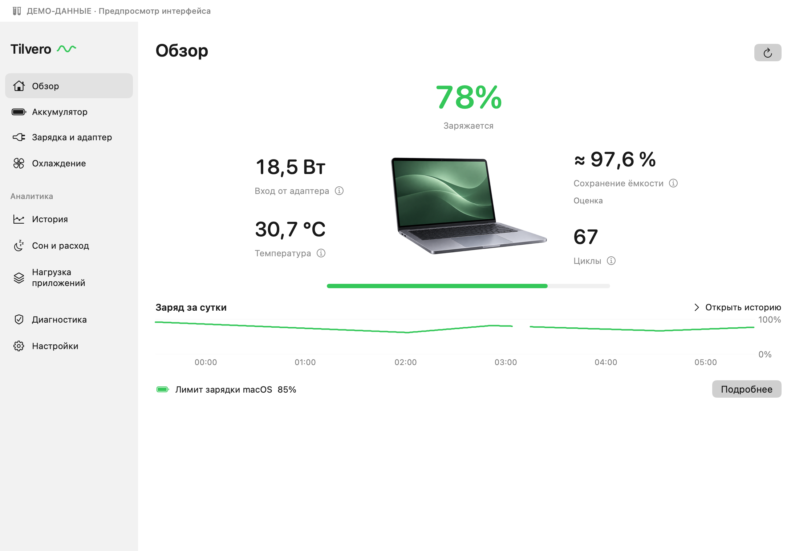
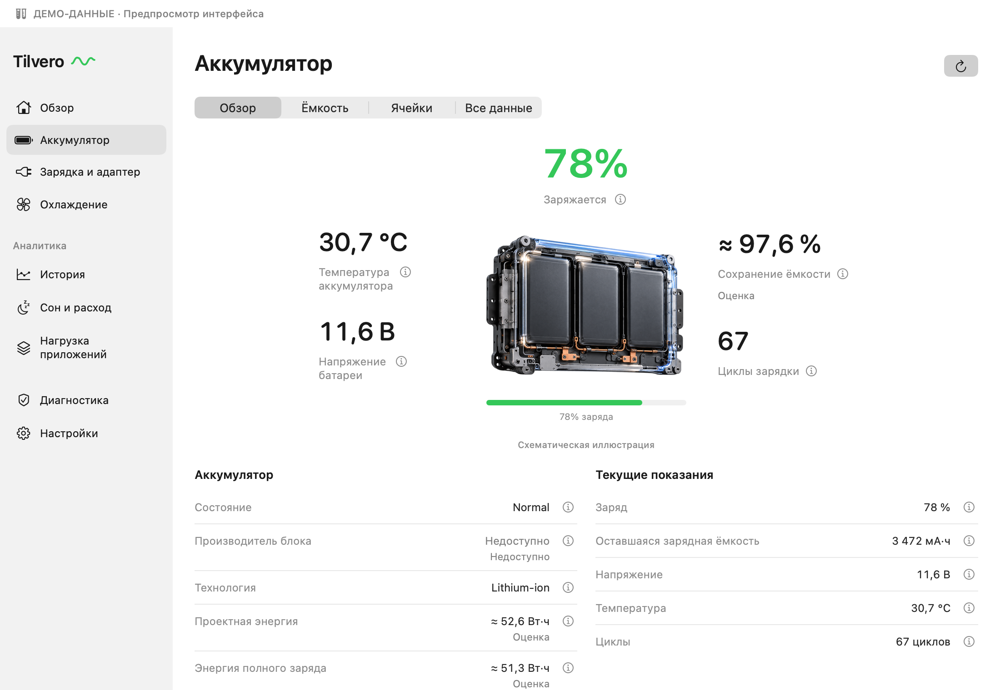
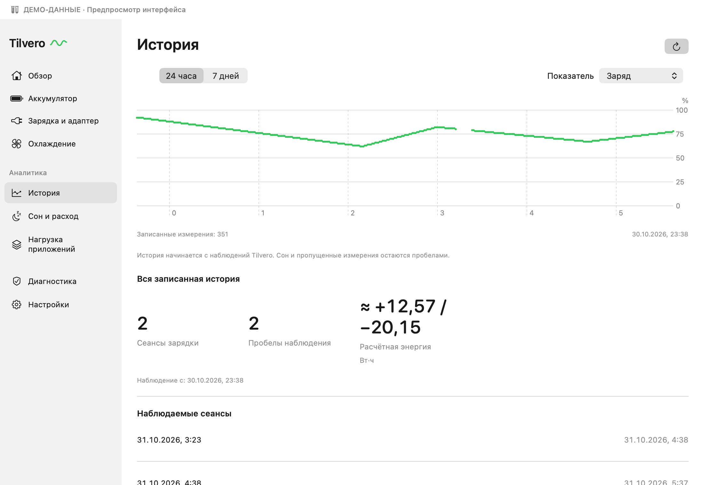
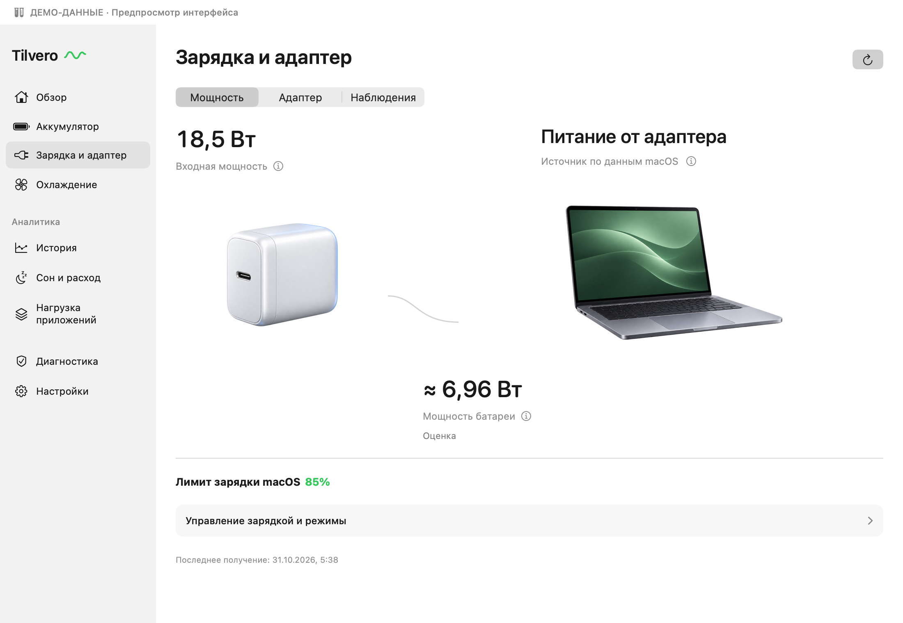

<p align="center">
  
</p>

<h1 align="center">Tilvero</h1>
<p align="center"><strong>Батарея, питание и активность вашего Mac — на виду.</strong></p>
<p align="center">Нативное приложение на Swift · Apple silicon · Работает без интернета</p>
<p align="center"><a href="README.md">English</a> · <strong>Русский</strong></p>


<sub>Сгенерированная иллюстрация; снимки нативного интерфейса — ниже. [Происхождение изображения](.github/assets/COVER_PROMPT.md).</sub>

Tilvero показывает состояние батареи и питания в строке меню, а подробности —
в удобном нативном окне. Следите за зарядкой, изучайте состояние батареи
и изменения со временем. Без аккаунта и облачного сервиса.

**Предварительная версия в исходниках для разработчиков.**
[Получить исходники](https://github.com/RaNDoM6913/Tilvero/releases/download/v0.1.0-beta.1/Tilvero-0.1.0-beta.1-source.zip)
· [Описание выпуска и контрольные суммы](https://github.com/RaNDoM6913/Tilvero/releases/tag/v0.1.0-beta.1)
· [Сборка и запуск](#сборка-и-запуск) · [План развития](ROADMAP.md)

Подписанная и нотарифицированная версия для Mac готовится. Планируемый DMG
**Monitoring Preview** будет работать только для чтения; в репозитории также
есть управление для разработки с отдельными проверками допуска.
[Доступность и установка](docs/INSTALL.md#русский).

## Ваш Mac в подробностях

| Раздел | Что показывает Tilvero |
| --- | --- |
| Батарея одним взглядом | Заряд и источник питания в строке меню; компактная панель с настройкой блоков и размера индикатора |
| Состояние батареи | Доступные ёмкость, температура, циклы и данные ячеек с источниками и временем измерения |
| Питание и зарядка | Раздельные мощность батареи, системная нагрузка и вход/возможности адаптера; чтение системного лимита зарядки |
| Активность приложений | Поиск процессов, нагрузка CPU, оценки энергии/мощности CPU, пробуждения и дисковый ввод-вывод с явным указанием неполных данных |
| История и отчёты | Локальные графики, минутные записи, часовые сводки и экспорт CSV/JSON с предпросмотром; разрывы остаются видимыми |
| Сон и разряд | Наблюдавшиеся приложением сон и пробуждение, текущие препятствия сну и явные отметки неполных данных |
| Удобная панель | Порядок и видимость блоков, русский и английский языки, размер значка и текста в строке меню |

Каталог описывает **115 полей**. Их доступность зависит от конкретного Mac;
отсутствующие показания остаются недоступными. Мониторингу не нужны права администратора.

## Интерфейс Tilvero

Нативный интерфейс отрисован из исходников с подставленными демоданными.
Иллюстрации схематичны; эти снимки не подтверждают поддержку аппаратного
управления или квалификацию релизного приложения.

<table>
  <tr>
    <td width="50%"><strong>Обзор</strong><br><a href=".github/assets/screenshots/ru/overview.png"></a></td>
    <td width="50%"><strong>Батарея</strong><br><a href=".github/assets/screenshots/ru/battery.png"></a></td>
  </tr>
  <tr>
    <td width="50%"><strong>История</strong><br><a href=".github/assets/screenshots/ru/history.png"></a></td>
    <td width="50%"><strong>Зарядка</strong><br><a href=".github/assets/screenshots/ru/charging.png"></a></td>
  </tr>
</table>

## Сборка и запуск

Нужны **Mac с Apple silicon, macOS 26.0+ и полная установка Xcode** с совместимым
macOS SDK и Swift 6. Отдельные Command Line Tools не являются проверенным путём сборки.

```sh
git clone https://github.com/RaNDoM6913/Tilvero.git
cd Tilvero
bash scripts/test.sh
bash scripts/build-local-app.sh
bash scripts/run-local.sh
```

Приложение открывается в строке меню. Нажмите на значок батареи для быстрой панели;
**«История и отчёты…»** открывает подробное окно, шестерёнка — настройки.
В Tilvero сочетание **⌘⌥B** переключает панель, **⌘,** открывает настройки.

Локальная сборка подписывается ad-hoc для разработки. Сборщик сохраняет работающую
копию; чтобы оставить существующую сборку, укажите новый каталог:

```sh
bash scripts/build-local-app.sh --output build/dev-candidates.noindex/my-build/Tilvero.app
```

Указанный путь не должен существовать. Запускайте одну копию для разработки.
[Установка и обновление](docs/INSTALL.md#русский) описывает хранение данных и будущий DMG.

## Границы предварительной версии

**Мощность приложения — оценка для CPU.** Полное электрическое потребление
приложения с учётом GPU и других устройств не измеряется. Получение текущего
Energy Impact macOS не реализовано. Закрытый доступ не превращает значение в ноль.

**Отчёты сна начинаются с наблюдавшихся событий.** Tilvero не восстанавливает
прошлые ночи по разрывам истории и не приписывает их расход отдельным приложениям.

**Управление требует отдельного допуска.** В исходниках есть «Не давать Mac
уснуть», сохраняемые режимы и нативный контроллер зарядки. Сохранение режима
не применяет его. Изменение лимита требует локальной проверки записи, чтения
и восстановления на конкретном Mac; разовая полная зарядка — дополнительной проверки.
Привилегированная запись зарядки, режимов питания и вентиляторов пока не квалифицирована.
Вентиляторы по умолчанию остаются под управлением системы.

Будущая конфигурация Monitoring Preview отключает предотвращение сна и действия
управления и не содержит привилегированного помощника. Обычная сборка исходников —
версия для разработки со своими проверками допуска. Симуляция явно помечена
**DEMO** и отделена от реальной истории. Подробности:
[совместимость](docs/COMPATIBILITY.md) и [архитектура управления](Helper/README.md).

## Данные остаются на Mac

Без аккаунта, облака и отправки телеметрии. История батареи хранится локально;
по умолчанию подробные записи сохраняются 30 дней, часовые сводки — до 365 дней.
В настройках можно сократить срок подробной истории или удалить её.

Идентификация процессов остаётся в памяти и исключена из истории батареи
и обычного диагностического экспорта. Серийные номера и идентификационные токены
скрыты в обычном интерфейсе. Просмотрите отчёт перед тем, как поделиться им.

## Помогите улучшить Tilvero

- [Сообщить об ошибке или предложить улучшение](https://github.com/RaNDoM6913/Tilvero/issues/new/choose)
- [Участие в разработке](CONTRIBUTING.md) — подготовка, модули и безопасные проверки
- [История изменений](CHANGELOG.md) · [План развития](ROADMAP.md) · [Совместимость](docs/COMPATIBILITY.md)
- [Подготовка выпуска](docs/RELEASING.md) · [Тестирование и проверки](docs/TESTING.md)

В сообщении об ошибке укажите модель Mac, версию macOS и версию исходников.
Перед приложением диагностики проверьте её на личные данные.

## Лицензия

Авторские права © 2026 [RaNDoM6913](https://github.com/RaNDoM6913).
Оригинальные исходники Tilvero, документация и графика репозитория используют
[GNU GPL только версии 3](LICENSE) (`GPL-3.0-only`). Сохраняйте уведомления
об авторстве и лицензии; при распространении производных работ выполняйте
требования GPL к исходному коду и той же лицензии.

Сторонние материалы сохраняют собственные уведомления:
[COPYRIGHT](COPYRIGHT) · [Сторонние материалы](THIRD_PARTY_NOTICES.md).
