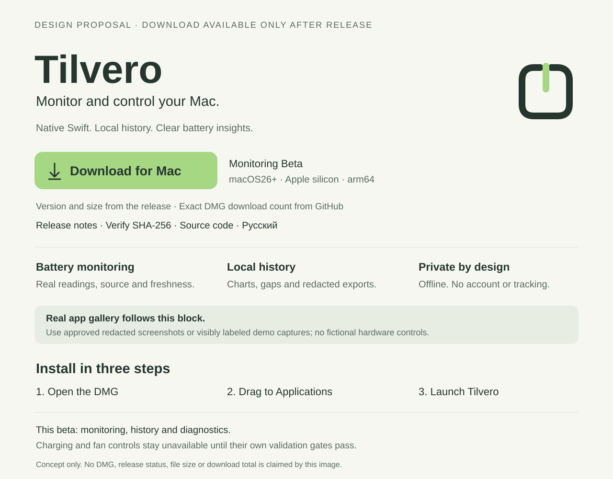

# Monitoring Preview release and download preparation

Status: implementation preparation, 2026-10-27. The owner selected **Monitoring Preview** and local internal **TEST** DMG preparation. Public binary uploads, tags, release drafts and publication need separate owner admission. This document describes the acceptance required before a Download button becomes available; it is not an installation claim.

The read-only GitHub observation at **2026-10-27T17:24:26Z** returned no releases and no published DMGs. This is a timestamped observation, not a continuously refreshed badge. README EN/RU therefore retain source-build availability without a Download button or numeric download badge.

## First release

Selected product scope: **Monitoring Preview**, macOS 26.0+, Apple silicon/arm64. Monitoring, history and diagnostics work without administrator approval. Physical control remains disabled. A proposed first public tag is `v0.1.0-beta.1`; it has not been created or published. The eventual preview is a GitHub prerelease; broader control support requires independent device/trust/restoration validation. A monitoring-only stable release can be considered separately after its own acceptance.

Ad-hoc builds remain explicitly labeled internal development artifacts. The recommended public DMG requires an owner-controlled Developer ID Application identity, Hardened Runtime, notarization and a real downloaded-install check. Missing signing credentials must produce a clear blocked result, never an automatic downgrade to ad hoc. A Developer ID Installer certificate is not required for the proposed drag-and-drop DMG.

Developer ID distribution depends on owner-managed Apple Developer Program access. Membership status has not been verified and this work performs no enrollment or purchase. Source builds and internal test packaging remain available without claiming Developer ID/notarization. See [Apple enrollment and pricing](https://developer.apple.com/help/account/membership/program-enrollment) for current terms.

## Intended public release contents

The following proposed names describe the future public release, not currently downloadable files. The internal TEST name must stay visibly distinct and must never be reused as the recommended public artifact.

- `Tilvero-0.1.0-beta.1-arm64.dmg`: a read-only disk image with Tilvero.app, an Applications shortcut and concise installation/legal information.
- `Tilvero-0.1.0-beta.1-source.zip`: corresponding source from the exact public release commit, with build scripts, original assets and licenses.
- `SHA256SUMS`: hashes of the finalized distributable files.
- `release.json`: version/build/tag/commit, channel, minimum OS, architecture, bundle identifiers, toolchain, signing/notarization result and final asset names/sizes/hashes. No credentials or private paths.
- Release notes: supported features, limitations, installation/update steps, source link and verification instructions.

The signed app includes LICENSE, COPYRIGHT and both root/helper third-party notices under a stable resource directory. Third-party authorship remains intact. DMG, source archive and metadata must refer to the same public commit; local private history is never a release source.

The Monitoring Preview package itself contains no helper executables, launch jobs or helper-trust enrollment metadata. Preserving third-party notices does not imply that a privileged component is installed.

## Installation and update

The intended first-run sequence is Download → open DMG → drag Tilvero to Applications → eject DMG → launch from Applications. Copying the monitoring app must not install or register a privileged service. Launching from the mounted image must not silently perform installation or enrollment.

The [English/Russian installation guide](INSTALL.md) is prepared, explicitly conditional on a trusted release. It separates installed-app steps from developer source-build/helper commands. No Gatekeeper or quarantine bypass is part of installation.

Use a permanent production app identifier before distribution and migrate allowlisted presentation/privacy/history settings and identity salt deliberately. The prototype and production version must not concurrently mutate the same history store. Preserve original data; a failed migration cannot masquerade as a successful empty history.

The first update route is manual. Quit the old app, replace it with the verified new bundle and preserve history/preferences. Future updates of a version with hardware ownership require verified restoration and signed helper/protocol/journal compatibility. Replacement of an app is not proof that a running helper was updated. Sparkle automatic updates, Homebrew and a dedicated website are later, separately scoped work.

## Release pipeline

1. Select a clean public commit and a not-yet-used tag; finalize version and monotonically increasing build number before signing. Build only from an isolated export of that exact committed tree, excluding local untracked/ignored inputs; use the same tree for corresponding source.
2. Build in an isolated destination. Do not mutate or package the running development bundle. Verify arm64/minimum OS, icon, legal resources, monitoring-only contents and source metadata.
3. Sign supplied executable code inside-out, then the app. No debug entitlement, fake Team ID or helper-trust bypass.
4. Create the final read-only DMG with its original volume icon and Applications shortcut; sign the DMG.
5. Submit the outermost DMG through `notarytool`, require Accepted and inspect the notary log; staple and validate the DMG ticket. A separate mandatory second app submission is not part of this route.
6. Test the actual quarantined download, mounted copy, Applications installation, relaunch/update and relevant offline behavior. A locally created image alone does not prove downloaded Gatekeeper acceptance.
7. Compute final checksums after signing/stapling. Verify the source archive and release manifest, then prepare a draft release with all assets.
8. Publish only the admitted release after final review. Prefer GitHub immutable releases so published tags/assets cannot be replaced; a packaging defect gets a new version.
9. Enable the matching Download button, release notes and metric badge only after the asset exists and its link is verified.

For a prerelease, link to its explicit tag/asset. GitHub's latest-full-release endpoint excludes prereleases and drafts; a generic latest link is not the beta download route.

## Local preparation tools

`Config/Release.json` owns the monitoring identity, version/build, beta tag, minimum OS
and architecture. Commit all public source/configuration/assets first. Select the exact
full commit from the clean checkout; tags and remote publication are not created by
these commands.

```sh
python3 scripts/release.py preflight --commit <full-commit> --signing-mode adhoc
python3 scripts/release.py prepare --commit <full-commit> --signing-mode adhoc
python3 scripts/release.py verify --manifest build/releases/v0.1.0-beta.1-TEST/release.json
```

The local result is explicitly named `Tilvero-0.1.0-beta.1-arm64-TEST.dmg` and is
**ad-hoc, not notarized, not accepted as a trusted download**. Preparation exports an
isolated committed source tree, builds Xcode Release in fresh DerivedData, includes
legal/icon/source metadata, mounts read-only, verifies mounted/copied signatures and
rejects a deliberately tampered inspection copy. It never launches the app or changes
hardware. The running `build/Tilvero.app` is preserved and checked before/after.
The source ZIP, manifest and final `SHA256SUMS` bind the same commit. The `verify`
command checks local artifact integrity/source binding; it does not confer trust or
prove a downloaded installation. Failed work stays under `.incomplete`; inspect it
before any retry. Reused output/tag/build numbers are rejected.

Developer ID preparation uses the separate `--signing-mode developer-id`, a committed
owner-supplied Team ID, `--identity` and `--notary-profile` (Keychain reference only).
It fails closed if those are absent. The outer DMG must be accepted by notarytool and
stapled/validated; actual independent quarantined-download acceptance still follows.
No automatic downgrade exists. The current `draft` command is a fail-closed gate:
remote draft creation/upload is deferred until trust, installed-device evidence and
separate owner admission are present. Never treat the local TEST image as an upload
candidate or publish the entire preparation directory.

## Download counts without in-app tracking

GitHub exposes `download_count` for each release asset. Report DMG downloads by summing only matching published Tilvero DMGs, with beta/stable scope and retrieval time. Do not count checksums, manifests or source ZIPs as application downloads. Exclude drafts; API failure is unavailable, not zero. Repeated requests, automation and validation downloads may affect the count: it is not unique people, installations or active users.

The on-demand tool is available now, using Python's standard library and the owner's existing GitHub CLI authorization. It issues only `gh api --method GET` requests and does not change authentication, repository settings or application code:

```sh
python3 scripts/release_stats.py --repo RaNDoM6913/Tilvero --channel all --format table
python3 scripts/release_stats.py --repo RaNDoM6913/Tilvero --channel beta --format json
python3 -m unittest discover -s Tests/ReleaseToolsTests -p test_release_stats.py
```

Run from the repository root. `--channel all|beta|stable` selects channels from GitHub's `prerelease` flag; `--format json|table` selects output. Every release page and each selected release's complete assets endpoint are traversed independently. Only uploaded `Tilvero-*-arm64.dmg` assets on published, non-draft releases count. Stable GitHub asset IDs are deduplicated; conflicting observations fail rather than returning a mixed partial total. Deleted assets are absent, renamed non-DMGs do not count, and replacements have new IDs. Totals describe currently visible assets, not lifetime downloads of deleted or renamed files.

JSON contains `availability`, `retrievedAt`, `attemptedAt`, `scope`, `dmgDownloads`, `perRelease` and `perAsset`. A successful empty observation returns `available` with 0 and “No published DMGs” in table output. Any inaccessible page, malformed count, API error, missing CLI or timeout returns `unavailable`, a null total and exit status 2; no partial number is advertised. There is no cache or background collector. If a consumer saves this JSON, it must preserve the original `retrievedAt`; an old observation cannot be relabeled current after refresh failure.

No app telemetry or scheduled collection is added. GitHub repository Traffic separately reports views/clones over a limited 14-day window; these do not measure DMG installations. No count badge is enabled before publication. After publication, an exact-current-DMG badge must link to that explicit release and match the asset's actual name. A Shields all-assets total must be labeled all assets, never DMG downloads or users.

## GitHub presentation

Keep a compact brand header, then one primary Download for Mac action with Preview/prerelease/arm64/macOS 26+ context, version and size **after publication**. Use the exact tag/asset URL with a plain text link and meaningful alt text for any graphic. Follow it with real, redacted screenshots or clearly labeled demo captures, a three-step installation guide, current capability matrix, changelog and support links. Preserve EN/RU parity and the GPL/authorship section. Do not add a disabled-looking fake download link, artificial download numbers, unearned CI badges or screenshots that imply unqualified hardware control.

Prepared now: compact existing brand artwork, honest source-build availability in both READMEs, capability table, conditional EN/RU install guide, changelog and release-note template. No new screenshots are published: the active app is left untouched, and its private telemetry has not been admitted as public screenshot content. A gallery needs separately privacy-checked demo/redacted captures. The current GitHub rendering and actual asset content type/link must be checked after admitted publication; a local document preview cannot establish those release gates.

The separate Social preview graphic is ready; its Settings upload still needs a normal authenticated browser session. It is independent of the README banner already published.

The following is a hierarchy proposal for after a qualified beta exists, not a current download page:



## Primary references

- [Apple: packaging Mac software](https://developer.apple.com/documentation/xcode/packaging-mac-software-for-distribution)
- [Apple: notarization prerequisites](https://developer.apple.com/documentation/security/notarizing-macos-software-before-distribution)
- [GitHub: releases API and latest semantics](https://docs.github.com/en/rest/releases/releases)
- [GitHub: immutable releases](https://docs.github.com/en/code-security/concepts/supply-chain-security/immutable-releases)
- [GitHub: repository traffic](https://docs.github.com/en/repositories/viewing-activity-and-data-for-your-repository/viewing-traffic-to-a-repository)
- [Shields: all-assets downloads scope](https://shields.io/badges/git-hub-downloads-all-assets-all-releases)

See [compatibility](COMPATIBILITY.md) and the [product roadmap](../ROADMAP.md) for current support and proposed product capabilities.
